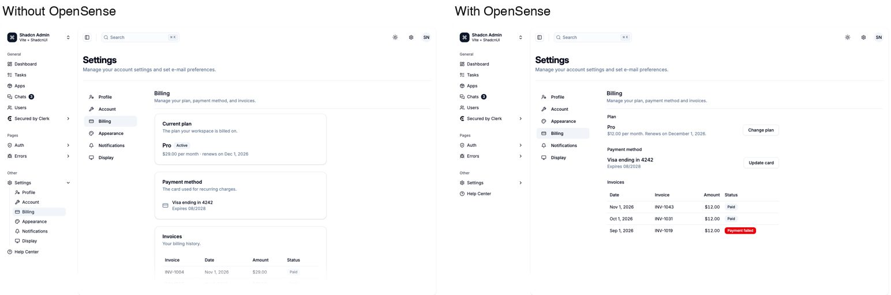
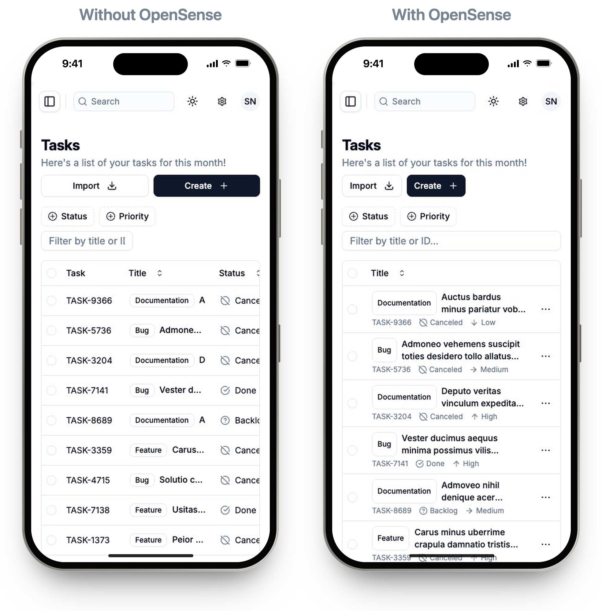
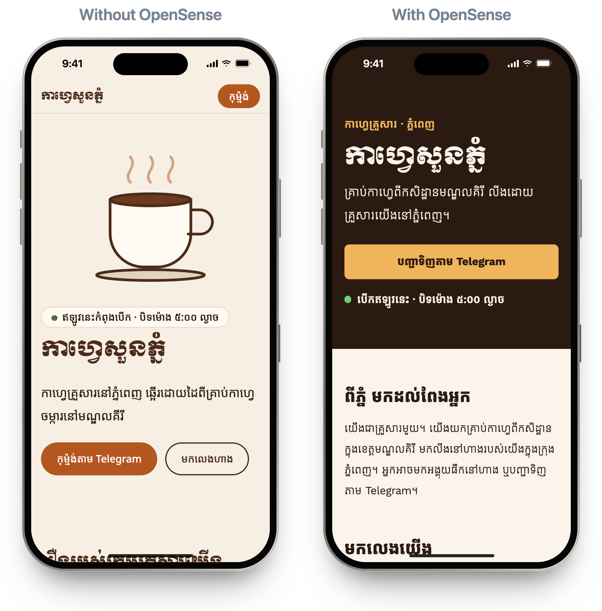

# OpenSense

**Design with intention.** OpenSense is an open-source skill that gives AI coding agents a designer's judgment when they build or change user interfaces.

> **Status: v0.2.0 preview.** v0.1.0 was tested in one with-and-without round on 8 tasks; see [How it was tested](#how-it-was-tested). v0.2.0 adds rules for shorter labels, icons and Khmer type, so far checked with one Khmer rerun. Feedback and test cases are welcome.

## Why

AI made building interfaces cheap, so they all look alike: a card around everything, a badge on everything, a description repeating every title, desktop layouts squeezed onto phones. People don't trust products that look like something their own agent could make.

OpenSense doesn't give your agent a style. It changes how the agent decides:

- understand the product and its people first;
- give every element a reason to exist;
- fit the context instead of a trend;
- look at the result before calling it done.

## What it does

- **Scales the process to the task.** A one-line tweak stays a one-line tweak. A new product gets a short design direction before any code.
- **Follows your project before its own taste.** The order is: your instructions, then your design system, then platform conventions, and only then OpenSense's defaults.
- **Cuts clutter, keeps what matters.** It removes descriptions that repeat titles, badges that never change and labels that repeat the question. What stays gets shorter: a phrase instead of a sentence, and an icon instead of words only where people already know the icon. It never cuts errors, prices and fees, consent text, warnings or accessible names.
- **Works across platforms and languages.**
  - Platforms: web, iOS, Android and desktop.
  - Scripts: right-to-left and non-Latin scripts, with Arabic and Khmer examples.
  - People: those new to smartphones.
- **Reports honestly.** It says what it checked and what it couldn't.

It is plain markdown, with no scripts, no commands and no setup: [`skills/opensense/SKILL.md`](skills/opensense/SKILL.md) plus six reference files that the agent reads only when a task needs them.

## Same idea, with and without OpenSense

Each idea below went to the same agent and model (Claude Code, Sonnet 5.5) twice: once on its own and once with OpenSense. Nothing else differed. These results are from v0.1.0, with one run per side, judged by the author from screenshots, and neither side could open its own result to check it. Read them as tendencies, not statistics; [How it was tested](#how-it-was-tested) has the limits.

| The idea | Agent on its own | With OpenSense | Better |
|---|---|---|---|
| A Khmer landing page for a family café in Phnom Penh | A generic coffee-cup illustration, numbered cards, and an invented claim about the farms | An opening-hours table with Monday marked closed and today highlighted, the address and hours in Khmer digits, and Telegram ordering steps, with nothing invented. It still put a small label above the title. | OpenSense |
| The main screen of an iOS habit tracker | Only an empty card with a 🔥 | The check-off loop, with no emoji and no all-caps date label | OpenSense |
| A Billing section in an admin app's Settings | Three cards, a filler description under each title, and an "Active" badge | Built like the other settings pages: no cards, no repeated descriptions, and badges only where the status varies | OpenSense |
| The Tasks page, made to work at 390 px wide | The desktop table squeezed, with its columns cut off | Stacked rows that read on a phone | OpenSense |
| Settings › Profile in Arabic | Translated and flipped right-to-left | The same, plus isolated mixed-direction text (a username stays left-to-right) and a localized "@mention" | OpenSense, narrowly |
| A clinic sign-up form for people new to smartphones | Kept a more useful hint ("as on your ID or insurance card") | Dropped the field label that repeated the question, and the header bar | Tie |
| Status labels in a Users list that are hard to tell apart | The same small change | The same small change | Tie |
| A busy dashboard, improved for a shop owner who checks it every morning | Rebuilt the page around the owner's morning | Cut the clutter but kept generic metrics. After a skill change, one rerun of this same task matched the agent on its own. | Agent on its own; a tie after the change |

## Install

Use **one** install method per agent. Installing twice loads two copies of the skill.

| Agent | Command | Tested |
|---|---|---|
| Claude Code (plugin) | `/plugin marketplace add Thith-thith/opensense`, then `/plugin install opensense@opensense` | Yes |
| Claude Code, Antigravity (skills CLI) | `npx skills add Thith-thith/opensense` | Yes |
| Codex, Gemini CLI, Cursor, Copilot and other agents that support Agent Skills | `npx skills add Thith-thith/opensense -a <agent>` | Not yet |
| Gemini CLI (extension) | `gemini extensions install https://github.com/Thith-thith/opensense` | Not yet |

## Use

Ask your agent for UI work as usual:

- "Add a billing page to settings."
- "This dashboard feels busy, clean it up."
- "Make the checkout work in Arabic."

OpenSense loads on its own for UI tasks. To be explicit, say "use opensense".

## What it won't do

- Impose a house style, a theme or a component kit.
- Override your explicit requests or your project's design system.
- Write design files into your project.
- Invent features, metrics, testimonials or user research.

## How it was tested

The 8 tasks [above](#same-idea-with-and-without-opensense) ran once per side. Five were changes inside a real open-source admin app, and three started from an empty folder or a new Expo app.

| | With OpenSense |
|---|---|
| Better (author's read of screenshots) | 5 tasks, with 2 ties and 1 loss. The loss was fixed and rerun as a tie. |
| Accessibility (Lighthouse) | The same or higher on 7 of 8 tasks. On the habit tracker it was 0.01 lower, with a different failure on each side. |
| Honest final report | 8 of 8 tasks, against 6 of 8 without |
| Loads for UI tasks, stays out of backend tasks | 33 of 33 trigger runs |

**Why this is a preview:**
- each side ran once;
- the judging was done by the author, not by independent judges;
- one task was used to revise the skill;
- the Arabic and Khmer haven't been checked by native readers.

[evals/results/round-1.md](evals/results/round-1.md) has every task, the honest losses and the cost (about $8.85).

The suite lives in [`evals/`](evals/) and runs on Claude Code's built-in `claude plugin eval`. [`evals/README.md`](evals/README.md) explains how to run it. The full design is in [`docs/design.md`](docs/design.md), and the original brief is in [`docs/brief.md`](docs/brief.md).

## License

MIT
